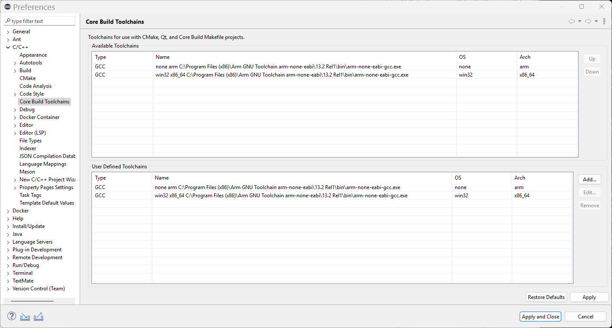
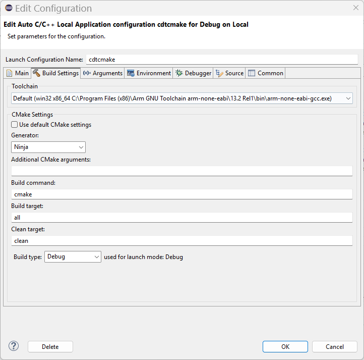
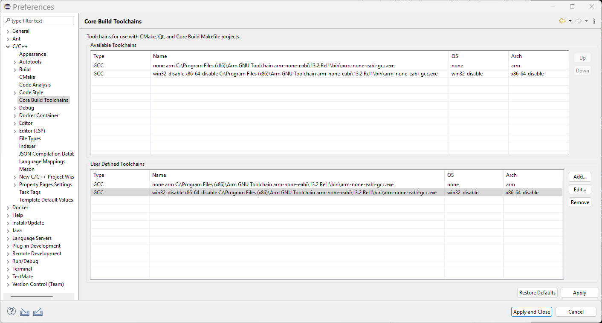
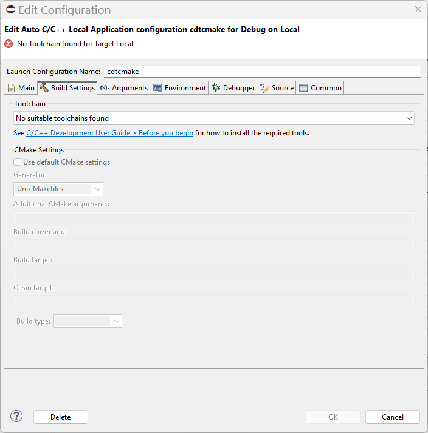

# Manual test: Edit Launch Configuration when there is no toolchain for the launch target

## Overview

This document describes the manual tests for [issue #932](https://github.com/eclipse-cdt/cdt/issues/932):
"[CMake] Launch Bar, Launch Configuration gear button fails to open Edit Launch Configuration dialog when no toolchain installed".

The tests check that, for a CMake project:

- the Edit Launch Configuration dialog opens when there is **no** toolchain for the launch target, instead of failing with a `NullPointerException`,
- the dialog explains the problem with an error message and a link to the help, and
- the dialog behaves as before when there **is** a toolchain for the launch target.

The following automated tests also cover this behaviour:

- `org.eclipse.cdt.cmake.ui.internal.tests.NoToolchainsBuildTabTest`
- `org.eclipse.launchbar.ui.tests.internal.CreateLaunchConfigTests.editExistingLaunchConfigOkEnabledWhenErrorFixedAndWarningRemains`

Added:

    20261023 John Moule
    Fix Edit Launch Configuration failing when there is no toolchain for the launch target
    https://github.com/eclipse-cdt/cdt/issues/932

## Prerequisites

Note: these prerequisites differ from the "Setup & prerequisites" in [README.md](README.md), which installs a gcc
toolchain. Do not follow those for this test, as this test needs a host without a native toolchain.

- A Windows PC that has **no** native toolchains installed that Eclipse CDT reports as OS `win32` and CPU Architecture `x86_64`.
- A cross compiler installed on the host, for example the Arm GNU Toolchain `arm-none-eabi` 13.2 Rel1:
  `C:\Program Files (x86)\Arm GNU Toolchain arm-none-eabi\13.2 Rel1\bin\arm-none-eabi-gcc.exe`.
  Eclipse CDT reports this compiler as OS `none` and CPU Architecture `arm`.
- The Launch Bar is visible and its Launch Target is set to **Local** (OS `win32`, CPU Architecture `x86_64`).

### How the toolchain state is switched

The cross compiler does not match the `Local` launch target, so by itself there is no toolchain for the launch target.
Rather than installing and uninstalling a native toolchain, the tests add a *User Defined Toolchain* that points at the cross
compiler but claims to be OS `win32` and CPU Architecture `x86_64`. This makes it match the `Local` launch target.
Editing the OS and CPU Architecture of that user defined toolchain to other values switches the state back to
"no toolchain for the launch target", and editing them back restores the toolchain.

## Setup

1. In Eclipse CDT, open **Preferences > C/C++ > Core Build Toolchains** and look at **Available Toolchains**.
   Confirm the cross compiler `arm-none-eabi-gcc.exe` is reported with OS `none` and CPU Architecture `arm`.
2. Under **User Defined Toolchains**, click **Add...** and:
   - choose type **GCC**,
   - give the same compiler path as the cross compiler above,
   - set OS to `win32` and CPU Architecture to `x86_64`,
   - click **Finish**, then **Apply and Close**.
3. Open **Preferences > C/C++ > Core Build Toolchains** again and confirm **Available Toolchains** now also reports
   `arm-none-eabi-gcc.exe` with OS `win32` and CPU Architecture `x86_64`, as well as the original `none` / `arm` entry.

   

4. Create a CMake Hello World project, for example named `cdtcmake`.

## Test cases

### Test case 1: there is a toolchain for the launch target (not failing)

1. Make sure the setup above has been completed, so the `win32` / `x86_64` user defined toolchain exists.
2. In the Launch Bar, click the Launch Configuration gear icon.

Expected:

- The Edit Configuration dialog opens.
- The message area shows "Set parameters for the configuration."
- On the **Build Settings** tab, the **Toolchain** drop-down shows the toolchain, for example
  `Default (win32 x86_64 C:\Program Files (x86)\Arm GNU Toolchain arm-none-eabi\13.2 Rel1\bin\arm-none-eabi-gcc.exe)`.
- No help link is shown.
- The CMake settings are enabled.
- The **OK** button is enabled.

3. Click **Cancel**.

### Test case 2: there is no toolchain for the launch target (failing before the fix)

1. In Eclipse CDT, open **Preferences > C/C++ > Core Build Toolchains > User Defined Toolchains**.
2. Select the `win32` / `x86_64` toolchain and click **Edit...**.
3. Change OS to `win32_disable` and CPU Architecture to `x86_64_disable` (any values other than `win32` and `x86_64` will do),
   click **Finish**, then **Apply and Close**.
4. Open **Preferences > C/C++ > Core Build Toolchains** again and confirm there is no longer a toolchain reported with
   OS `win32` and CPU Architecture `x86_64`.

   

5. In the Launch Bar, click the Launch Configuration gear icon.

Expected:

- The Edit Configuration dialog opens. (Before the fix it did not open, and a `NullPointerException` was logged.)
- With the **Main** tab active, the message area shows the error "No Toolchain found for Target Local".
- With the **Build Settings** tab active:
  - the message area shows the error "No Toolchain found for Target Local",
  - the **Toolchain** drop-down shows "No suitable toolchains found",
  - the help link "C/C++ Development User Guide > Before you begin" is shown,
  - the CMake settings are disabled.
- The **OK** button is disabled.
- The **Cancel** button is enabled.

6. Click the help link "C/C++ Development User Guide > Before you begin".

Expected:

- The Eclipse help opens on the "Before you begin" topic.
- Known limitation: on Windows the Edit Configuration dialog is modal, so the help view cannot be used until the dialog is closed.

7. Click **Cancel**.

### Test case 3: the toolchain is restored (error clears)

1. In **Preferences > C/C++ > Core Build Toolchains > User Defined Toolchains**, select the toolchain, click **Edit...**,
   set OS back to `win32` and CPU Architecture back to `x86_64`, click **Finish**, then **Apply and Close**.
2. In the Launch Bar, click the Launch Configuration gear icon.

Expected: the same results as test case 1. There is no need to restart Eclipse.

## Clean up

Remove the user defined toolchains added for this test: in **Preferences > C/C++ > Core Build Toolchains > User Defined
Toolchains**, select each toolchain that was added and click **Remove**, then **Apply and Close**.
